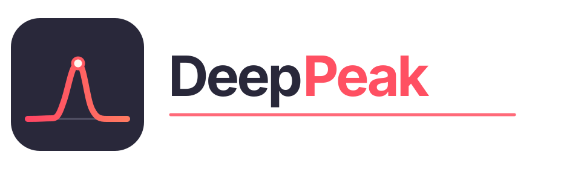

DeepPeak
========

.. list-table::
   :width: 100%
   :widths: 35 65
   :header-rows: 1

   * - Badge
     - Status
   * - Python versions
     - |mps-python|
   * - Documentation
     - |mps-docs|
   * - Tests
     - |mps-ci| |mps-coverage|
   * - PyPI
     - |mps-pypi| |mps-downloads|
   * - Conda
     - |mps-conda| |mps-conda-downloads| |mps-conda-release|

Peak detection, trace analysis, and dilution-series tooling for 1D signals.

Locate peaks in noisy one-dimensional traces and compare detections with known
positions in synthetic data. Start with the classical pipeline before comparing it
with a trained deconvolution model.

See the `usage guide <https://github.com/MartinPdeS/DeepPeak/blob/HEAD/USAGE.rst>`__ for further examples and implementation details.
Open the `project notebook in Colab <https://colab.research.google.com/github/MartinPdeS/DeepPeak/blob/master/notebooks/wavenet_training.ipynb>`__.

Installation
------------

Requires Python ``>=3.10``.

.. code-block:: console

   $ python -m pip install DeepPeak

Install from the ``martinpdes`` Conda channel:

.. code-block:: console

   $ conda install -c martinpdes deeppeak

For an editable source installation:

.. code-block:: console

   $ git clone https://github.com/MartinPdeS/DeepPeak.git
   $ cd DeepPeak
   $ python -m pip install -e .

Detect peaks in a synthetic trace
---------------------------------

.. code-block:: python

   """
   Classical Detection Pipeline with Stable Results
   =================================================

   Generate a noisy synthetic signal, run the classical detector, wrap its raw
   output in a stable ``DetectionResult``, and visualize the result.
   """

   # %%
   # Generate a trace
   # ----------------
   import matplotlib.pyplot as plt
   import numpy as np

   from DeepPeak.core import DetectionResult, Trace
   from DeepPeak.detection import find_peaks_standard
   from DeepPeak.generation import Gaussian, SignalGenerator, UniformCount

   sequence_length = 500
   generator = SignalGenerator(sequence_length=sequence_length)
   dataset = generator.generate(
       n_samples=1,
       kernel=Gaussian(
           amplitude=(4.0, 8.0),
           position=(80.0, 420.0),
           width=8.0,
       ),
       peak_count=UniformCount(bounds=(3, 3)),
       noise_std=0.15,
       seed=42,
   )
   trace = Trace(signal=dataset.signals[0], dx=1.0)

   # %%
   # Detect peaks and create a stable result object
   # -----------------------------------------------
   peak_indices, properties = find_peaks_standard(
       trace.signal,
       height=1.0,
       hysteresis=0.5,
       holdoff_samples=10,
   )
   detection = DetectionResult(
       peaks=peak_indices,
       properties=properties,
       detection_kwargs={
           "height": 1.0,
           "hysteresis": 0.5,
           "holdoff_samples": 10,
       },
       threshold=1.0,
   )
   print(f"Detected {detection.peak_count} peaks at {detection.peaks.tolist()}")

   # %%
   # Plot the detector output
   # ------------------------
   figure, axis = plt.subplots(figsize=(10, 3.5))
   axis.plot(trace.signal, color="black", linewidth=0.9, label="signal")
   axis.axhline(detection.threshold, color="C1", linestyle="--", label="threshold")
   axis.scatter(
       detection.peaks,
       trace.signal[detection.peaks],
       color="C3",
       zorder=3,
       label="detected peaks",
   )
   axis.set_xlabel("Sample index")
   axis.set_ylabel("Amplitude")
   axis.legend()
   figure.tight_layout()
   figure

Documentation
-------------

Use the `DeepPeak documentation <https://martinpdes.github.io/DeepPeak/>`__ to work through
examples and look up the inputs and return values of individual functions.

Contributing
------------

Bug reports, worked examples, and documentation corrections are welcome.
To set up a development checkout and run the tests, follow the `contributing guide <https://github.com/MartinPdeS/DeepPeak/blob/HEAD/CONTRIBUTING.md>`__.

Contact
-------

For questions, contact `Martin Poinsinet de Sivry-Houle <mailto:martin.poinsinet.de.sivry@gmail.com?subject=DeepPeak>`__.

License
-------

See the `DeepPeak license <https://github.com/MartinPdeS/DeepPeak/blob/HEAD/LICENSE>`__ for terms of use.

.. |mps-python| image:: https://img.shields.io/pypi/pyversions/deeppeak.svg
   :alt: Supported Python versions
   :target: https://pypi.org/project/deeppeak/

.. |mps-pypi| image:: https://img.shields.io/pypi/v/deeppeak.svg
   :alt: PyPI version
   :target: https://pypi.org/project/deeppeak/

.. |mps-downloads| image:: https://img.shields.io/pypi/dm/deeppeak.svg
   :alt: Monthly PyPI downloads
   :target: https://pypistats.org/packages/deeppeak

.. |mps-docs| image:: https://github.com/MartinPdeS/DeepPeak/actions/workflows/deploy_documentation.yml/badge.svg
   :alt: Documentation
   :target: https://martinpdes.github.io/DeepPeak/

.. |mps-ci| image:: https://github.com/MartinPdeS/DeepPeak/actions/workflows/tests.yml/badge.svg
   :alt: Tests
   :target: https://github.com/MartinPdeS/DeepPeak/actions/workflows/tests.yml

.. |mps-conda| image:: https://anaconda.org/martinpdes/deeppeak/badges/version.svg
   :alt: Anaconda version
   :target: https://anaconda.org/martinpdes/deeppeak

.. |mps-conda-downloads| image:: https://anaconda.org/martinpdes/deeppeak/badges/downloads.svg
   :alt: Anaconda downloads
   :target: https://anaconda.org/martinpdes/deeppeak

.. |mps-conda-release| image:: https://anaconda.org/martinpdes/deeppeak/badges/latest_release_relative_date.svg
   :alt: Latest Anaconda release
   :target: https://anaconda.org/martinpdes/deeppeak
